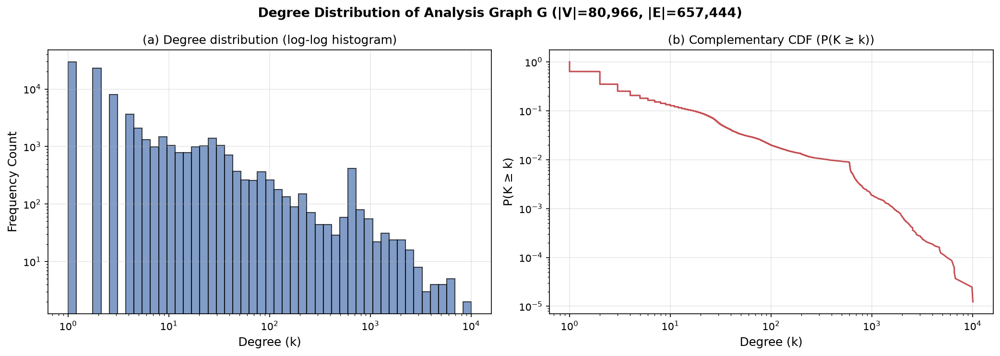
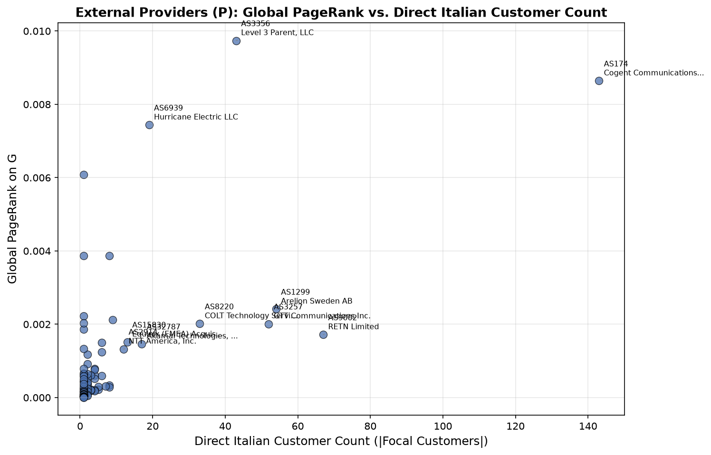
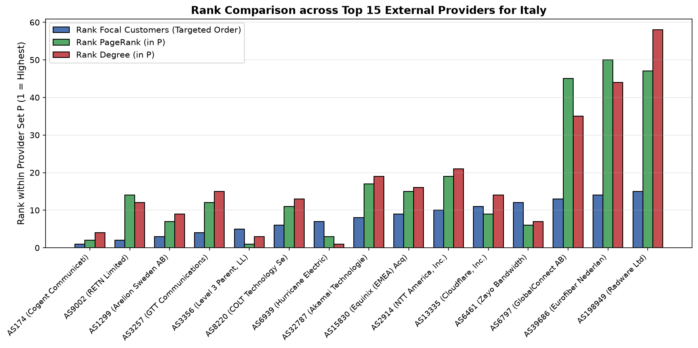
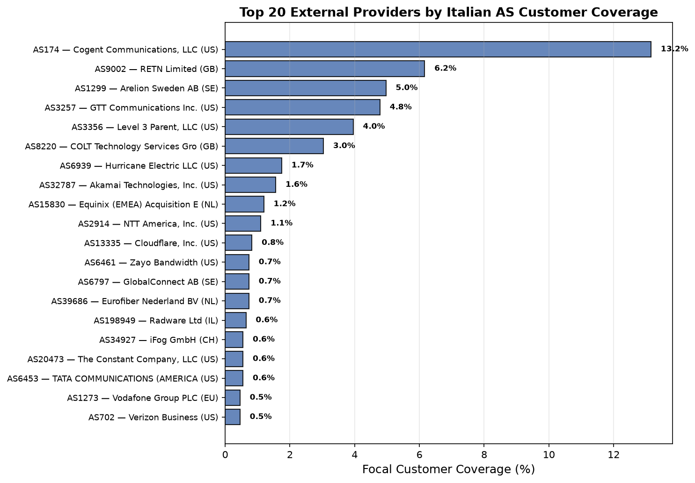
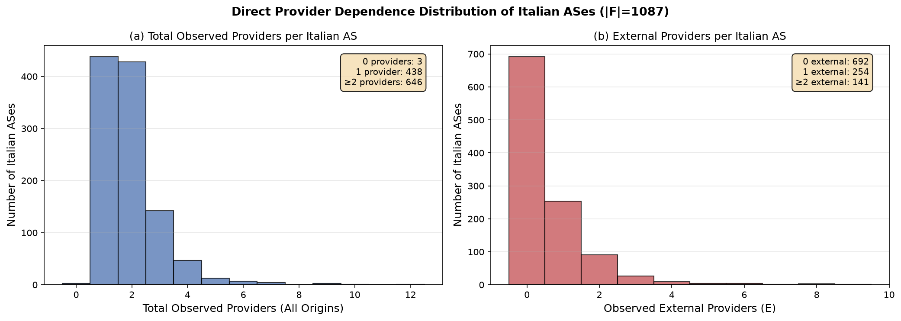

# Findings & Data Summary: Provider Importance and Dependence (Student A)

This document provides the complete empirical and theoretical results for the analysis of provider prominence
and Italian autonomous systems' transit dependency, based on the CAIDA snapshot `20261001`.

---

## 1. Data Summary Table

The table below summarizes the structural properties of the global topology, the largest connected component (G),
and the baseline node sets:

| Metric | Value | Description |
|---|---:|---|
| **Graph Nodes (|V|)** | 80,966 | Number of unique ASes appearing in relationships |
| **Graph Edges (|E|)** | 657,444 | Unique undirected relations (peer + p2c merged) |
| **Connected Components** | 1 | Entire graph forms a single connected component G |
| **Average Degree ⟨k⟩** | 16.24 | Mean links per AS |
| **Median Degree** | 2 | Median links per AS |
| **Max Degree** | 10,066 | AS6939 (Hurricane Electric LLC) |
| **Min Degree** | 1 | Minimum links observed for an AS |
| **Graph Density** | 2.005805e-04 | Sparsity level 2|E| / (|V|(|V|-1)) |
| **Focal ASes (|F|)** | 1,087 | Registered in Italy (`IT`), 1.343% of G |
| **External ASes (|E|)** | 79,433 | Non-IT with resolved country, 98.107% of G |
| **Unknown Country ASes** | 446 | Nodes in G without a valid country code |
| **Candidate Providers (|P|)** | 107 | External ASes directly serving at least one Italian AS |

---

## 2. Degree Distribution & Structural Topology

The degree distribution of G exhibits heavy-tailed behavior typical of scale-free Internet router/AS topologies.
While the median degree is only 2, the top hubs possess thousands of peer and customer adjacencies.

- **Empirical shape**: Visualized via log-log histogram and Complementary Cumulative Distribution Function (CCDF).
- **Methodological caution**: Following rigorous network science guidelines, heavy-tailed visual linearity on log-log scales
  is noted as consistent with power-law behavior, but no formal power-law hypothesis is asserted without statistical goodness-of-fit testing.

---

## 3. Global PageRank and Convergence Verification

PageRank was computed on the unweighted, undirected graph G using the standard course specifications:
- Damping factor $\alpha$: `0.85`
- Teleportation: `uniform` (uniform $1/|V|$)
- Convergence tolerance: `1e-06`
- Max iterations: `500`
- **Sum of PageRank vector**: `1.00000000` (conservation holds within numerical precision)
- **Exact L1 Stationary Residual**: `4.253274e-02` (verified against theoretical Markov fixed point)

### Top 10 Nodes by Global PageRank vs. Top 10 by Degree

| Rank | ASN | Org / Entity Name | Degree | PageRank | Rank Degree |
|---|---|---|---:|---:|---:|
| 1 | AS3356 | Level 3 Parent, LLC | 6,583 | 0.009739 | #4 |
| 2 | AS174 | Cogent Communications, LLC | 6,579 | 0.008641 | #5 |
| 3 | AS6939 | Hurricane Electric LLC | 10,066 | 0.007437 | #1 |
| 4 | AS24482 | HostSG | 9,858 | 0.006078 | #2 |
| 5 | AS7018 | AT&T Enterprises, LLC | 2,339 | 0.004522 | #38 |
| 6 | AS49544 | i3D.net B.V | 6,748 | 0.003899 | #3 |
| 7 | AS35280 | F5 Networks SARL | 6,378 | 0.003871 | #6 |
| 8 | AS6461 | Zayo Bandwidth | 2,853 | 0.003864 | #23 |
| 9 | AS137409 | GSL Networks Pty LTD | 6,207 | 0.003391 | #7 |
| 10 | AS32590 | Valve Corporation | 5,218 | 0.002664 | #9 |

---

## 4. Provider Prominence: Global Centrality vs. Local Italian Market Concentration

The candidate provider set $P$ comprises **107 external ASes** providing direct transit to Italian networks.
Crucially, **global centrality (PageRank/Degree) and local market concentration (Italian Customer Count) measure fundamentally different phenomena**.

### Top 15 External Providers by Italian Customer Count

| Rank (Targeted) | ASN | Organization | Country | Italian Customers | Coverage (% of F) | Degree | PageRank | Rank PR in P | Rank Deg in P |
|---|---|---|---|---:|---:|---:|---:|---:|---:|
| #1 | AS174 | Cogent Communications, LLC | US | 143 | 13.2% | 6,579 | 0.008641 | #2 | #4 |
| #2 | AS9002 | RETN Limited | GB | 67 | 6.2% | 2,333 | 0.001715 | #14 | #12 |
| #3 | AS1299 | Arelion Sweden AB | SE | 54 | 5.0% | 2,637 | 0.002414 | #7 | #9 |
| #4 | AS3257 | GTT Communications Inc. | US | 52 | 4.8% | 1,850 | 0.002011 | #12 | #15 |
| #5 | AS3356 | Level 3 Parent, LLC | US | 43 | 4.0% | 6,583 | 0.009739 | #1 | #3 |
| #6 | AS8220 | COLT Technology Services Group | GB | 33 | 3.0% | 2,095 | 0.002015 | #11 | #13 |
| #7 | AS6939 | Hurricane Electric LLC | US | 19 | 1.7% | 10,066 | 0.007437 | #3 | #1 |
| #8 | AS32787 | Akamai Technologies, Inc. | US | 17 | 1.6% | 1,608 | 0.001464 | #17 | #19 |
| #9 | AS15830 | Equinix (EMEA) Acquisition Ent | NL | 13 | 1.2% | 1,839 | 0.001516 | #15 | #16 |
| #10 | AS2914 | NTT America, Inc. | US | 12 | 1.1% | 1,502 | 0.001322 | #19 | #21 |
| #11 | AS13335 | Cloudflare, Inc. | US | 9 | 0.8% | 2,094 | 0.002117 | #9 | #14 |
| #12 | AS6461 | Zayo Bandwidth | US | 8 | 0.7% | 2,853 | 0.003864 | #6 | #7 |
| #13 | AS6797 | GlobalConnect AB | SE | 8 | 0.7% | 725 | 0.000335 | #45 | #35 |
| #14 | AS39686 | Eurofiber Nederland BV | NL | 8 | 0.7% | 498 | 0.000290 | #50 | #44 |
| #15 | AS198949 | Radware Ltd | IL | 7 | 0.6% | 240 | 0.000313 | #47 | #58 |

### In-Depth Qualitative Discrepancies & Case Studies

Comparing the rankings reveals key architectural dynamics:

1. **AS174 (Cogent Communications) — Local Market Dominance**:
   - Holds Rank #1 in Italian customer count (143 Italian ASes, 13.2% coverage).
   - However, globally in $P$ it ranks #2 in PageRank and #4 in Degree.
   - *Interpretation*: Cogent operates as the primary direct commercial transit bridge for Italian ISPs, but is not the sole global connectivity hub.

2. **AS6939 (Hurricane Electric) — Peering Giant with Moderate Local Transit Role**:
   - Ranks #1 globally by degree (10,066 edges) due to an open, aggressive settlement-free peering policy at global IXPs.
   - Yet, it ranks only #7 in Italian customer count (19 focal customers, 1.7% coverage) and #3 in PageRank (0.007437).
   - *Interpretation*: Hurricane Electric interconnects with vast numbers of networks, but Italian ASes utilize it much more frequently as a settlement-free peer than as an authoritative upstream transit provider.

3. **AS3356 (Level 3 / Lumen) — High Recursive Structural Influence**:
   - Ranks #1 globally in PageRank (0.009739) despite ranking #3 in Degree (6,583 edges).
   - *Interpretation*: PageRank rewards connections to other highly central nodes. Level 3 is densely interconnected with top Tier-1 cores and Tier-2 providers.

4. **AS9002 (RETN Limited) — Regional Eurasian Focus**:
   - Ranks #2 in Italian customers (67 ASes, 6.2% coverage), but ranks #8 in Degree and #9 in PageRank within $P$.
   - *Interpretation*: RETN has a targeted European and trans-Eurasian footprint, making it a favorite cost-effective transit choice for Southern/Eastern Europe despite lower global degree.

---

## 5. Focal AS Dependency & Multihoming

Examining direct upstream transit relationships among the 1,087 Italian ASes:

- **0 observed providers**: 3 ASes (0.3%).
  - These ASes rely entirely on peer links (e.g. peering at MIX Milan, NAMEX Rome) or have unobserved private BGP sessions.
- **Exactly 1 observed provider**: 438 ASes (40.3%).
  - Topologically, these represent single-homed networks susceptible to single-link disconnection if transit fails.
- **2 or more observed providers (multihomed)**: 646 ASes (59.4%).
  - Exhibiting explicit structural redundancy.

Looking specifically at **external providers** ($E$):
- 692 Italian ASes have no direct foreign provider (relying either on domestic Italian upstreams like TIM/Fastweb or direct peering).
- 254 Italian ASes rely on exactly one foreign provider.
- 141 Italian ASes are multihomed to two or more foreign providers.

---

## 6. Formal Limitations

1. **BGP Visibility**: CAIDA relationship datasets are reconstructed from public BGP route collectors (Route Views, RIPE RIS). P2P and private interconnects are known to be under-represented.
2. **Undirected Topological Reachability**: While graph paths represent topological adjacency, real Internet packets obey valley-free export policies (Gao-Rexford). Undirected graph paths are an upper bound on true reachability.
3. **Geographic vs. Administrative Country**: AS country metadata reflects administrative registration, which does not always strictly coincide with point-of-presence (PoP) physical hardware placement.
4. **Capacity & Traffic Invariance**: The model is unweighted and topological; edge removal reflects loss of adjacency, not saturated bandwidth or congestive rerouting dynamics.