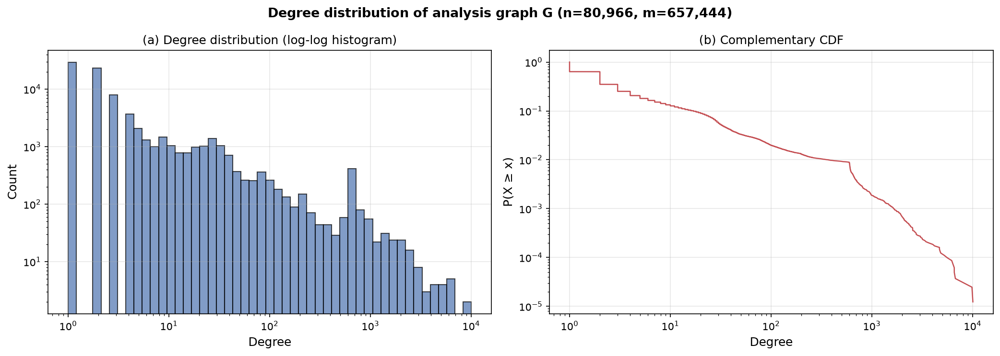
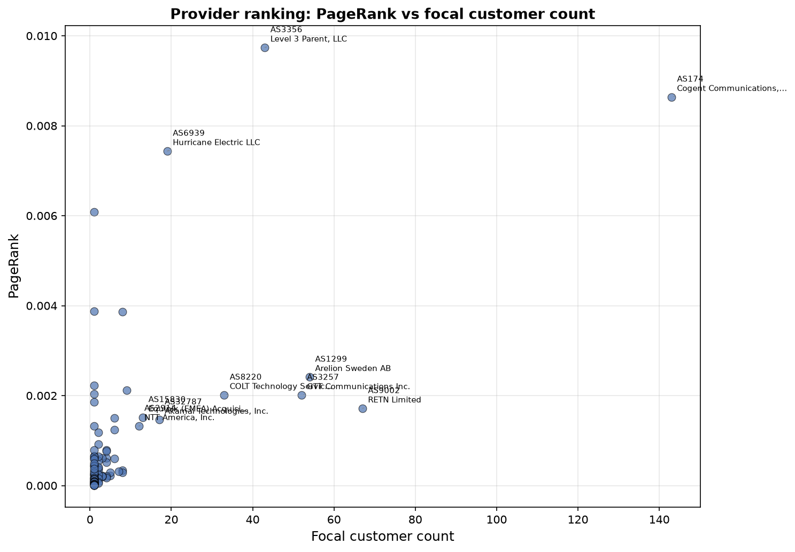
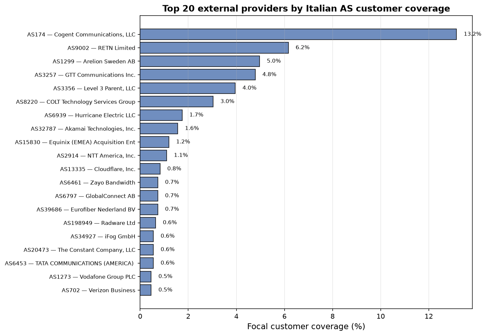
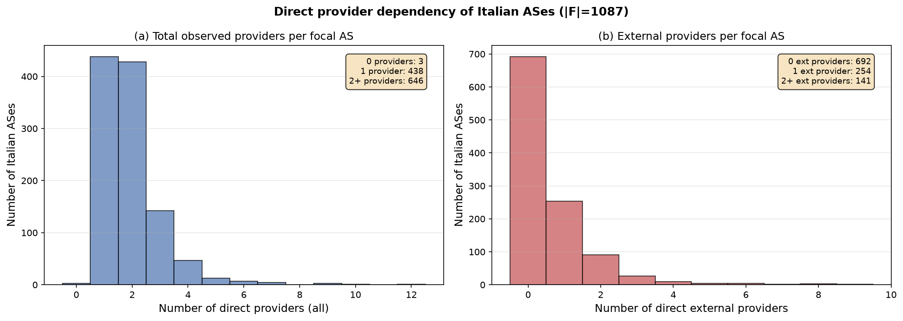

# Findings: Provider importance and dependence

**Analysis graph G**: 80,966 nodes, 657,444 edges (single connected component).
**Focal set F (IT)**: 1,087 ASes.
**Candidate providers P**: 107 external ASes with at least one provider-to-customer link to F.

---

## Degree distribution

- Mean degree: 16.2
- Median degree: 2
- Max degree: 10,066
- Min degree: 1

The degree distribution is highly right-skewed with most nodes having low degree
and a small number of hubs with very high degree. No formal power-law fit is
attempted here; the visual shape is consistent with a heavy-tailed distribution
but this alone does not establish a power law.

---

## PageRank

- Damping factor: 0.85
- Teleportation: uniform
- Weighted: False
- Sum of PageRank: 1.000000

### Top 10 nodes by PageRank

| Rank | ASN | Degree | PageRank |
|------|-----|--------|----------|
| 1 | AS3356 | 6,583 | 0.009739 |
| 2 | AS174 | 6,579 | 0.008641 |
| 3 | AS6939 | 10,066 | 0.007437 |
| 4 | AS24482 | 9,858 | 0.006078 |
| 5 | AS7018 | 2,339 | 0.004522 |
| 6 | AS49544 | 6,748 | 0.003899 |
| 7 | AS35280 | 6,378 | 0.003871 |
| 8 | AS6461 | 2,853 | 0.003864 |
| 9 | AS137409 | 6,207 | 0.003391 |
| 10 | AS32590 | 5,218 | 0.002664 |

### Top 10 nodes by degree

| Rank | ASN | Degree | PageRank |
|------|-----|--------|----------|
| 1 | AS6939 | 10,066 | 0.007437 |
| 2 | AS24482 | 9,858 | 0.006078 |
| 3 | AS49544 | 6,748 | 0.003899 |
| 4 | AS3356 | 6,583 | 0.009739 |
| 5 | AS174 | 6,579 | 0.008641 |
| 6 | AS35280 | 6,378 | 0.003871 |
| 7 | AS137409 | 6,207 | 0.003391 |
| 8 | AS39120 | 5,606 | 0.002655 |
| 9 | AS32590 | 5,218 | 0.002664 |
| 10 | AS132337 | 4,828 | 0.002302 |

---

## Provider rankings

### Top 15 external providers by focal customer count

| Rank | ASN | Organization | Country | Focal customers | Coverage | Degree | PageRank |
|------|-----|-------------|---------|-----------------|----------|--------|----------|
| 1 | AS174 | Cogent Communications, LLC | US | 143 | 13.2% | 6,579 | 0.008641 |
| 2 | AS9002 | RETN Limited | GB | 67 | 6.2% | 2,333 | 0.001715 |
| 3 | AS1299 | Arelion Sweden AB | SE | 54 | 5.0% | 2,637 | 0.002414 |
| 4 | AS3257 | GTT Communications Inc. | US | 52 | 4.8% | 1,850 | 0.002011 |
| 5 | AS3356 | Level 3 Parent, LLC | US | 43 | 4.0% | 6,583 | 0.009739 |
| 6 | AS8220 | COLT Technology Services Group Limited | GB | 33 | 3.0% | 2,095 | 0.002015 |
| 7 | AS6939 | Hurricane Electric LLC | US | 19 | 1.7% | 10,066 | 0.007437 |
| 8 | AS32787 | Akamai Technologies, Inc. | US | 17 | 1.6% | 1,608 | 0.001464 |
| 9 | AS15830 | Equinix (EMEA) Acquisition Enterprises B | NL | 13 | 1.2% | 1,839 | 0.001516 |
| 10 | AS2914 | NTT America, Inc. | US | 12 | 1.1% | 1,502 | 0.001322 |
| 11 | AS13335 | Cloudflare, Inc. | US | 9 | 0.8% | 2,094 | 0.002117 |
| 12 | AS6461 | Zayo Bandwidth | US | 8 | 0.7% | 2,853 | 0.003864 |
| 13 | AS6797 | GlobalConnect AB | SE | 8 | 0.7% | 725 | 0.000335 |
| 14 | AS39686 | Eurofiber Nederland BV | NL | 8 | 0.7% | 498 | 0.000290 |
| 15 | AS198949 | Radware Ltd | IL | 7 | 0.6% | 240 | 0.000313 |

Coverage percentages can overlap (an Italian AS may have multiple external providers).

PageRank and focal customer count measure different aspects: PageRank reflects
topological centrality in the full undirected graph, while focal customer count
is a direct measure of how many Italian ASes list this provider. The two rankings
need not agree.

---

## Focal AS dependency

- Focal ASes with 0 observed providers: 3
- Focal ASes with exactly 1 provider: 438
- Focal ASes with 2+ providers: 646

These counts reflect *observed* direct provider relationships only.
Peer connectivity, private peering, and incomplete BGP visibility mean that
a single observed provider does not imply a single point of failure.

---

## Limitations

- CAIDA relationships are inferred from BGP data and are incomplete.
- Registration country does not identify physical equipment location.
- Links carry no bandwidth/traffic information; undirected paths may be
  unusable under real routing policies.
- PageRank is computed on the undirected topology; it measures structural
  centrality, not traffic importance.
- Provider counts per focal AS reflect observed relationships only;
  missing observations may undercount actual providers.
