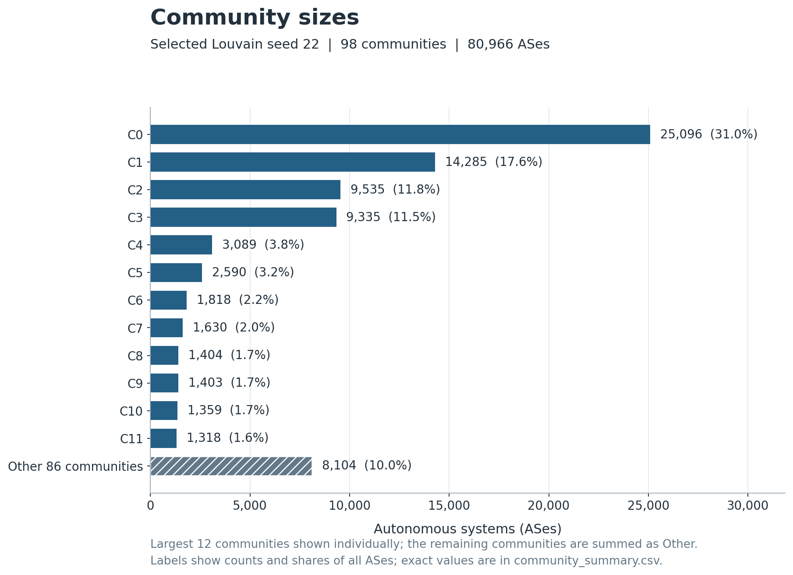
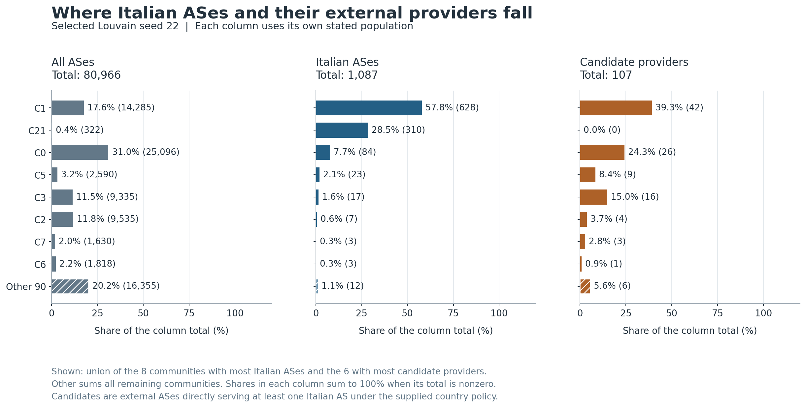
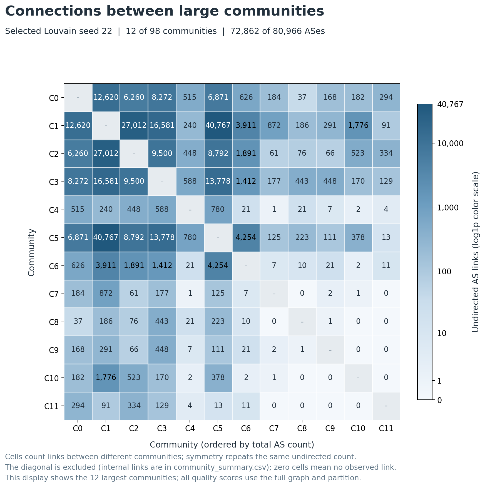

# Communities in the observed AS graph

Louvain found 98 communities in the selected partition of the 80,966-node, 657,444-edge baseline graph. Seed 22 had the highest modularity (0.516034) among the configured runs.

The communities describe this inferred, undirected topology. They do not establish geographic, ownership or routing-policy boundaries.

## Seed comparison

| Seed | Communities | Modularity | Ncut, sum | Course NMI | InfoMap, bits/step | Selected |
|---|---:|---:|---:|---:|---:|:---:|
| 11 | 100 | 0.513871 | 29.258479 | 0.438012 | 12.724612 |  |
| 22 | 98 | 0.516034 | 28.525930 | 0.444588 | 12.710488 | yes |
| 33 | 102 | 0.505821 | 29.742906 | 0.443413 | 12.693575 |  |

The modularity range was 0.505821-0.516034 (spread 0.010213). The selected run maximizes modularity; the other three course measures evaluate the same partitions. An exact modularity tie is broken by the smaller seed.

Seed 33 has the shortest map-equation length (12.693575 bits/step), whereas the selected seed 22 has 12.710488 bits/step. The measures therefore do not all prefer the same partition.

Pairwise label agreement is reported separately from the course edge-end NMI. ARI equals 1 and variation of information equals 0 for identical partitions.

| Seeds | Adjusted Rand index | Variation of information, bits |
|---|---:|---:|
| 11 / 22 | 0.813532 | 1.013684 |
| 11 / 33 | 0.685643 | 1.713063 |
| 22 / 33 | 0.715093 | 1.565674 |

These runs assess the seed sensitivity of one algorithm on one snapshot. They are not a comparison of different algorithms or a statistical confidence interval.

## Selected partition

Community 0 is largest: 25,096 nodes (31.0% of G). The five largest communities together contain 75.8% of all nodes. Community IDs are assigned by descending size, then smallest ASN; they are labels, not identities shared across seeds.

The 1,087 Italian focal ASes appear in 15 communities. Community 1 contains the most: 628 (57.8% of F). Italian ASes account for 4.4% of that community's nodes.

The 107 candidate external providers appear in 12 communities. Community 1 contains the most candidates: 42 (39.3% of P). Provider membership here is derived from direct provider-to-Italian-customer records, independently of Student A's PageRank ranking.

Leading communities by Italian-AS count:

| Community | All nodes | Italian ASes | Share of F | Candidate providers |
|---|---:|---:|---:|---:|
| 1 | 14,285 | 628 | 57.8% | 42 |
| 21 | 322 | 310 | 28.5% | 0 |
| 0 | 25,096 | 84 | 7.7% | 26 |
| 5 | 2,590 | 23 | 2.1% | 9 |
| 3 | 9,335 | 17 | 1.6% | 16 |
| 2 | 9,535 | 7 | 0.6% | 4 |
| 6 | 1,818 | 3 | 0.3% | 1 |
| 7 | 1,630 | 3 | 0.3% | 3 |

Community 21 has the second-largest Italian-AS count: 310 of its 322 nodes are registered in Italy (96.3%). This distinguishes the number of Italian ASes from their share within a community.

The complete table, including smaller communities and recorded country labels, is in `community_summary.csv`. `community_provider_membership.csv` identifies each candidate ASN and its selected community. Registration labels do not locate equipment.

## Figures



Community sizes use the selected partition. Any Other category is the sum of omitted communities, as labelled in the figure; the full table retains every community.



Population shares use separate baseline denominators for all nodes, Italian ASes and candidate providers. The view's selection and any Other aggregation are labelled; they do not change the analysis graph or score calculations.



The heatmap displays aggregated intercommunity edge counts for the labelled largest-community subset, with its displayed transformation noted on the color bar. The diagonal is masked because it would represent internal edges. The CSV `community_edges.csv` includes internal counts and every community pair with an edge. Its unordered rows count each original edge once; symmetric heatmap cells repeat the same pair for readability.

## Method and checks

Input snapshot: `20261001`. Package policy: `nonempty_nonfocal`. Baseline fingerprint: `abfe3cfdfeae63524c7e5e755cd6e8992783f6108de23186c86de21af6316a80`.

Louvain: unweighted G, resolution 1, threshold 1e-07, no maximum level, explicit NetworkX backend. The first configured seed served as the pilot and is reused in this comparison. Nodes and edges come from the loader's stable ASN ordering.

All four scores use the full G and each complete partition. Modularity was checked independently with NetworkX. Ncut is a sum. Course NMI is mutual information of edge-end community labels divided by their entropy; it can capture disassortative dependence too. InfoMap scores the supplied Louvain partition using recorded uniform teleportation, damping 0.85 and base-2 logarithms. No Infomap partition optimization ran.

The locally computed stationary walk converged in 112 iterations, with total L1 residual 6.88012e-13 against tolerance 1e-12. The prepared walk was reused across all partitions. No importance-result files were read.

Every seed assigns every G node exactly once. Summary totals reconcile to G/F/E/P, and each community satisfies `degree_volume = 2*internal_edges + boundary_edges`. Quotient counts sum to the original edge count. Source/input/output hashes, library versions, seed settings, scores and runtimes are in `community_run_manifest.json`.

## Limitations and outstanding decisions

- **unresolved_country_labels**: Non-country labels are preserved in the supplied external set. Agree on their treatment and version any changed package before final robustness runs.
- Supplied country assignments were preserved, including 18 EU-labelled ASes. Affected candidate providers: AS1273. A revised convention may change composition/provider counts while leaving topology-only partitions and scores unchanged if G stays the same.
- **crlf_hash_portability**: These CSVs use CRLF. Git newline conversion can change byte hashes; agree on a portable artifact policy before final shared runs.
- CAIDA relationships are inferred and incomplete. Registration country is not equipment location, and the graph contains no traffic or bandwidth information.
- An undirected connection does not establish a policy-valid Internet route. This community analysis does not measure outage losses or perform provider removals.
- Three seeds characterize only the configured runs. Louvain is a heuristic, and similar modularity values do not imply identical node assignments.

Course definitions: `Part2_community.pdf`, PDF pp. 17, 48, 66, 72-73 and 133. See `analysis/resilience/COMMUNITY_METRICS.md` for the implemented conventions and retained hand calculations.

Reproduce from the repository root:

```powershell
python -m analysis.resilience.run_communities
```
