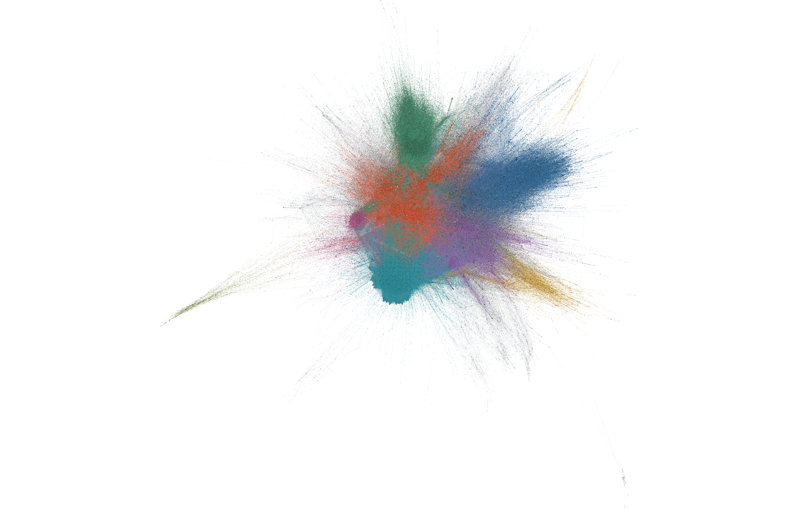
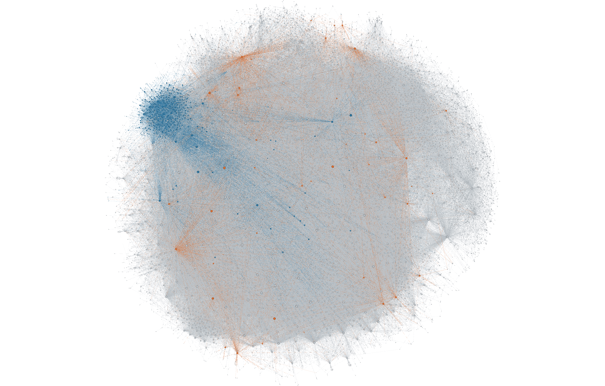
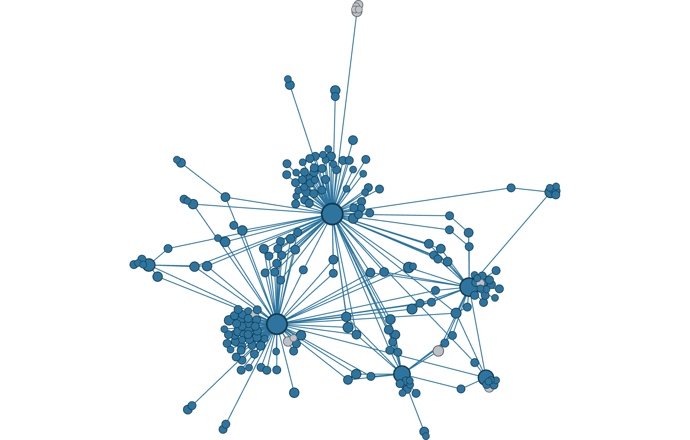
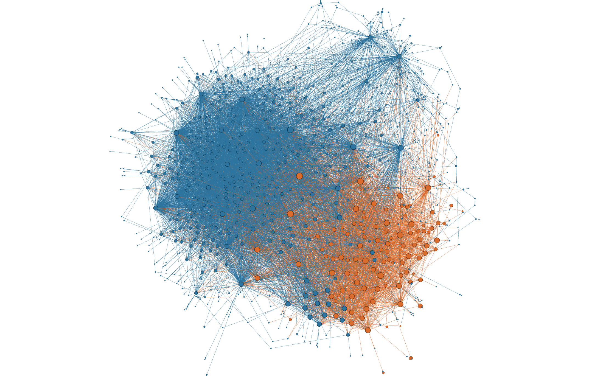
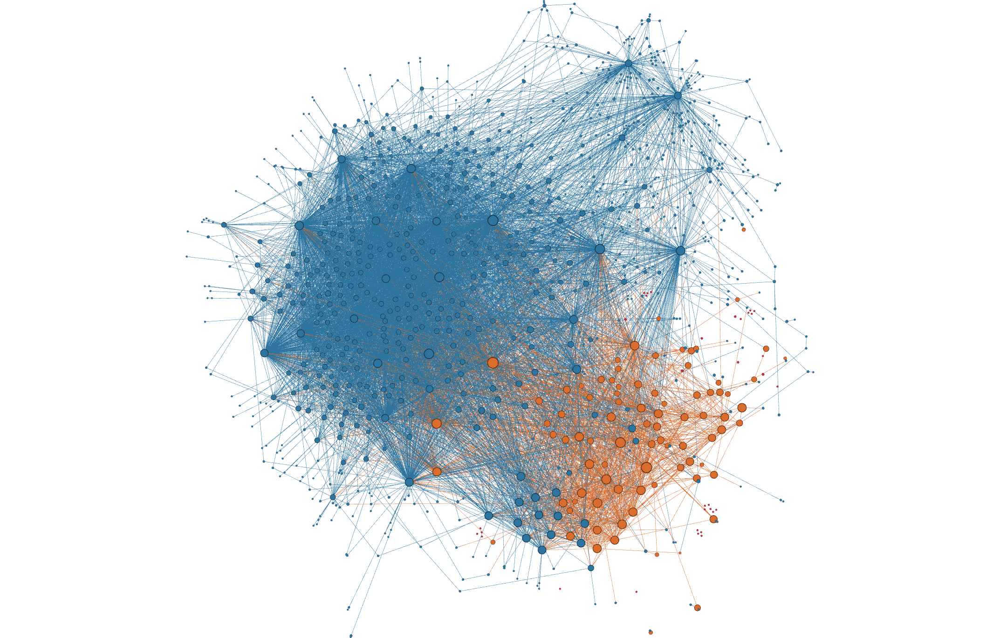
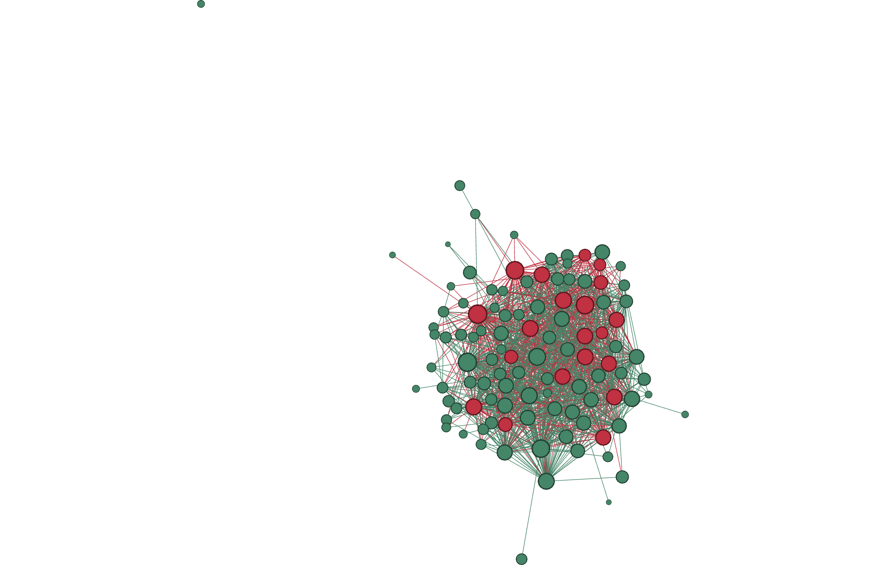

# Gephi network views

These six native Gephi Desktop 0.11.4 screenshots use the validated graph and
the saved seed-22 Louvain partition. The project retains all 98 community IDs.

- [Captioned PDF gallery](Gephi_Screenshots.pdf).
- [Contact sheet](contact_sheet.png).
- [Editable six-workspace project](Student_B_Network_Views.gephi).
- [Input definitions and counts](input_manifest.json).
- [Visualization checks](visualization_validation.json).

Open the `.gephi` file in Gephi Desktop and switch views using the workspace
tabs. Each workspace contains its saved subgraph; an active filter is not needed
to restore the intended view after reopening.

| View | Nodes | Edges | Display |
|---|---:|---:|---|
| Full graph | 80,966 | 657,444 | Eight largest communities coloured separately; others grey |
| Community 1 | 14,285 | 138,088 | Italian ASes, candidate providers and other ASes |
| Community 21 | 322 | 416 | A community with 310 Italian ASes |
| Italy and providers, baseline | 1,194 | 9,879 | Induced display of Italian ASes and candidate providers |
| Italy and providers, after 20 removals | 1,174 | 7,940 | Same surviving coordinates and sizes; reachability status highlighted |
| Candidate providers | 107 | 1,390 | First 20 targeted providers highlighted |

All edges are undirected and unweighted. The smaller workspaces omit edges
leaving their displayed node sets. In particular, the Italian/provider display
omits other transit ASes and is not the graph used to calculate reachability.

## Screenshots and legends

### Full graph: communities



[Legend](01_full_communities_legend.svg). C0-C7 have distinct colours; the other
90 communities share grey. The raw IDs remain in `community_id`.

### Community 1



[Legend](02_community_1_legend.svg). Blue marks Italian ASes, orange candidate
providers and grey other ASes. This community contains 628 Italian ASes and
42 candidate providers; Italian ASes are 4.4% of its nodes.

### Community 21



[Legend](03_community_21_legend.svg). Blue marks Italian ASes and grey other ASes.
This community contains 310 Italian ASes among 322 nodes, with no candidate
providers. Its predominantly Italian composition differs from community 1.

### Italy and providers: baseline



[Legend](04_italy_providers_before_legend.svg). Blue marks 1,087 Italian ASes;
orange marks 107 candidate providers. Other transit nodes are omitted.

### Italy and providers: after 20 targeted removals



[Legend](05_italy_providers_after20_legend.svg). Blue marks Italian ASes retaining
an external connection, red the 41 losing one, and orange surviving providers.
Status is calculated on the full post-removal graph. The baseline and after-20
GEXF exports verify identical surviving coordinates and sizes.

### Candidate providers



[Legend](06_candidate_providers_legend.svg). Red marks the first 20 providers
in the fixed targeted order; green marks the remaining 87. Node size reflects
global baseline degree, not degree in this induced provider subgraph.

## Layout and styling

The full view uses an exploratory OpenOrd pass stopped early, then 150 completed
ForceAtlas2 iterations. The initial OpenOrd iteration-property request was not
applied, so no fixed seed or completed OpenOrd schedule is claimed. The saved
project preserves the exact delivered coordinates.

Detail views use two ForceAtlas2 passes. The first has LinLog off, scaling 10,
strong gravity 0.01; the second has LinLog on, scaling 0.5, strong gravity 0.001.
Barnes-Hut is enabled, Dissuade Hubs is off and edge-weight influence is zero.
Iterations per pass are 180 for community 1, 450 for community 21, 400 for the
Italian/provider baseline and 800 for providers. The after-20 view reuses the
baseline layout without another layout pass.

Node sizes map `log(1 + baseline degree)` linearly: 10-100 in the full graph,
10-80 in community 1, 8-24 in community 21, 8-45 in both Italian/provider views
and 10-35 for providers. Sizes across separately ranked views are not directly
comparable. Labels are hidden; inspect ASNs and organizations in Data Laboratory.

The PNGs capture Gephi's Overview canvas at scale 2. They are not simulated
renderings. The PDF and contact sheet place captions around the same screenshots.
Distances are layout coordinates, not geography, latency or traffic. Positions
of disconnected nodes in an induced subgraph have no geographical meaning.

## Reproduce the graph input

From the repository root with the resilience dependencies installed:

```powershell
python -m analysis.resilience.export_gephi
```

Import the resulting `internet_seed22.gexf` into Gephi. It includes the saved
community IDs, `community_key` text labels, roles, baseline degrees, removal
positions and full-graph reachability labels. Use text equality on
`community_key`, `focal_or_provider` and `candidate_provider` for the displayed
subsets, then the layout/styling settings above. The complete baseline remains
in a separate workspace from the materialized after-20 subgraph.

The large regenerable input and raw desktop execution records are not included
in this repository. The smaller before/after GEXF exports and saved project are
included, with screenshot hashes and checks of all 1,174 surviving positions and
sizes in `visualization_validation.json`. All six saved workspaces were reopened
and checked against their expected node and edge counts.
