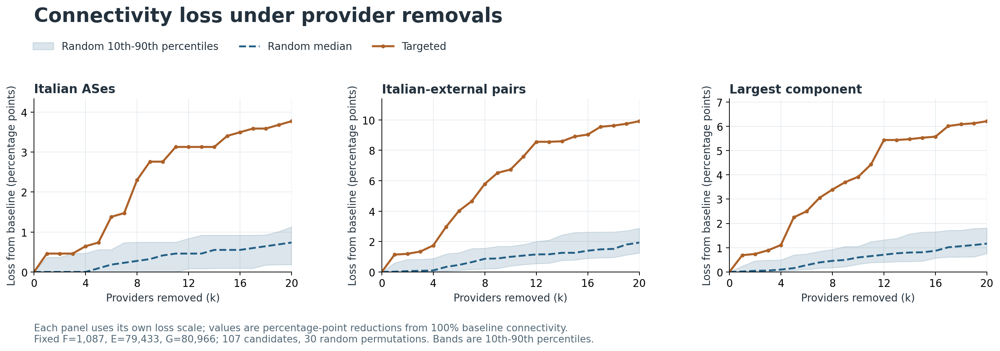
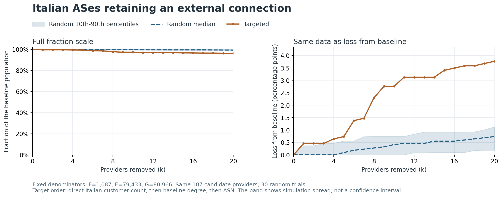
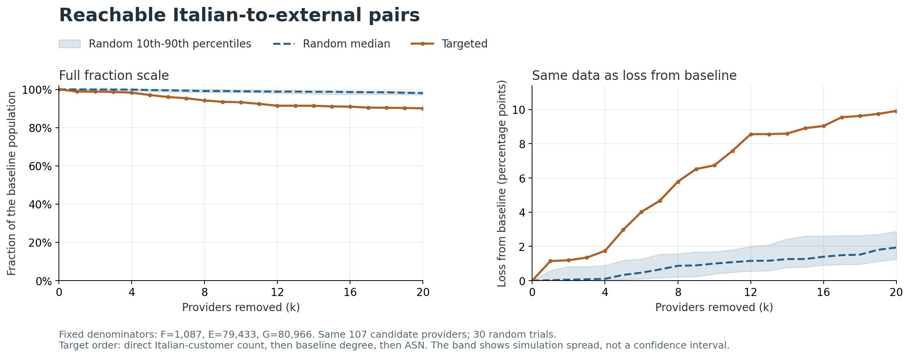
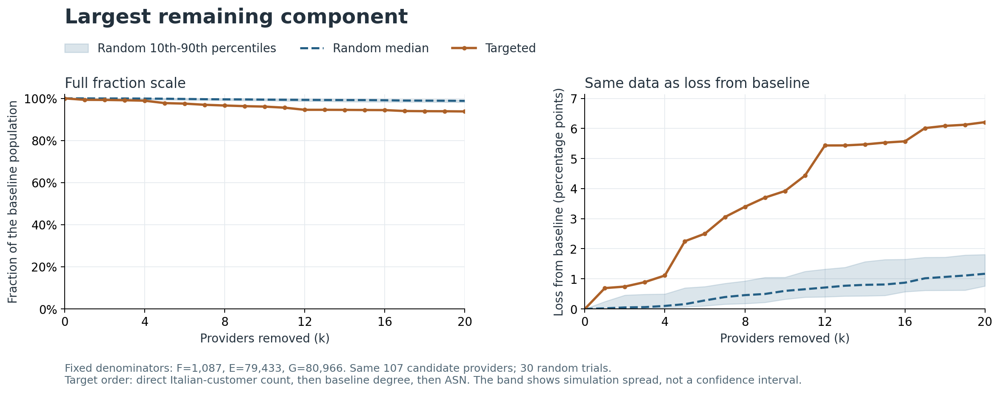

# Provider removals and topological connectivity

The primary experiment uses the supplied v1 baseline: 80,966 nodes, 1,087 Italian ASes, 79,433 external ASes and 107 candidate providers. It compares one targeted sequence with 30 uniform random permutations, for k=0..20 cumulative provider removals.

At k=20:

| Connectivity measure | Targeted retained | Random median | Random 10th-90th percentiles |
|---|---:|---:|---:|
| Italian ASes retaining an external connection | 96.2282% | 99.2640% | 98.8684%-99.8160% |
| Reachable Italian-to-external pairs | 90.0832% | 98.0681% | 97.1234%-98.7554% |
| Largest remaining component | 93.7900% | 98.8322% | 98.1904%-99.2396% |

## Interpretation

- **Italian ASes retaining an external connection**: the targeted retained fraction is 3.0359 percentage points below the random median at k=20.
- **Reachable Italian-to-external pairs**: the targeted retained fraction is 7.9850 percentage points below the random median at k=20.
- **Largest remaining component**: the targeted retained fraction is 5.0422 percentage points below the random median at k=20.

These comparisons describe the configured endpoint, not a guarantee that the targeted curve is worse at every k or in every random trial. The provider order was fixed from distinct Italian-customer counts, baseline degree and ASN; it did not use PageRank.

The pair measure falls both when external endpoints are deleted and when components separate. Even if G remained connected after k deletions from E, its maximum pair fraction would be `(|E|-k)/|E|`, not 1. Provider-customer coverage is therefore not itself a prediction of the observed connectivity loss.

## Curves



The overview shows loss in percentage points with a separate vertical scale for each metric. Every individual figure below also shows the complete fraction scale from 0 to 100%. Random bands are the 10th-90th percentiles of simulation outcomes, not confidence intervals for real Internet outages.







## Country-label sensitivity

The main run preserves the supplied country assignments. A separate scenario excludes non-assigned country labels from E and P while retaining those nodes as transit nodes. The shared CSV package is never rewritten. This is a sensitivity analysis, not a claim that both students have agreed on a new package convention.

The alternate scenario uses E=79,415 and P=106; G and F are unchanged. The removed candidate in this package is AS1273, labelled EU. Each scenario uses its own frozen baseline denominators and candidate pool, so the comparison includes both classification and removal-order effects.

Comparison at the common removal count k=20:

| Measure | v1 targeted | Alternate targeted | v1 random median | Alternate random median |
|---|---:|---:|---:|---:|
| Italian ASes retaining an external connection | 96.2282% | 96.3201% | 99.2640% | 99.5400% |
| Reachable Italian-to-external pairs | 90.0832% | 90.1766% | 98.0681% | 98.2068% |
| Largest remaining component | 93.7900% | 93.7986% | 98.8322% | 98.9452% |

Complete alternate orders, runs and percentile summaries are saved in `sensitivity/eu_excluded/`. The main conclusions should be checked against both scenarios when choosing the shared classification convention.

## Methods and reproducibility

- One uniformly shuffled, sorted candidate pool per fixed seed; prefix deletions accumulate across k.
- Every trial starts from the same graph. ASNs are removed individually, including incident edges.
- Connected components are recomputed with SciPy sparse graph routines after every deletion.
- For each remaining component C, count focal nodes f_C and external nodes e_C. The three measures are `sum(f_C where e_C>0)/|F|`, `sum(f_C*e_C)/(|F|*|E|)` and `largest_component_size/|G|`, using fixed baseline denominators.
- Baseline values equal 1, cumulative metrics never increase, and order/score checks run before results are exported. All random trials and the targeted sequence use the same k values and candidate pool within each scenario.
- The first random trial is the runtime pilot and is retained in the full experiment. Random seeds and per-trial runtime are recorded in `robustness_run_manifest.json`.

## Limits and remaining coordination

The data are inferred and incomplete. Registration country does not locate equipment. Edges carry no traffic or bandwidth; undirected paths may violate routing policy. These ASN-removal scenarios do not estimate users disconnected, traffic loss or an actual outage. Results cover one country and snapshot, and organizations with multiple ASNs are not removed as one entity.

The main run's country convention and byte/LF input hashes are recorded explicitly. Shared classification sign-off, Student A's PageRank convergence correction and current course submission/disclosure instructions remain collaboration items; none is silently treated as completed by this experiment.

Reproduce from the repository root:

```powershell
python -m analysis.resilience.run_robustness --hash-policy newline-compatible
```
